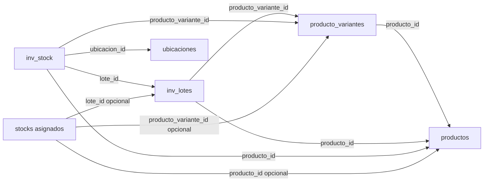
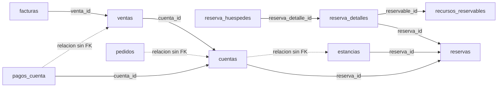

# Diagnóstico de normalización hasta tercera forma normal

> Fotografía anterior a la activación. El [estado actualizado](normalizacion-aplicada.md) documenta las 149 tablas y los cambios aplicados.

## Resultado y alcance

Se revisó la estructura completa de **hotel_bugambilias**, base principal local del proyecto `D:\Developer\laravel\hotel-bugambilia`, y se contrastaron los puntos prioritarios con el código y consultas agregadas.

**Todavía no se certifica toda la base en 3FN.** Este trabajo entrega el inventario estructural, hallazgos medidos y las decisiones necesarias para normalizar por etapas. Las dependencias funcionales se definen por las reglas del negocio; no pueden deducirse completamente del nombre de una columna, una clave `id` o una muestra de registros.

| Elemento observado | Cantidad |
|---|---:|
| Tablas | 148 |
| Columnas | 1.700 |
| Registros contados, incluidos borrados lógicos | 2.594.970 |
| Tablas con clave primaria | 148 de 148 |
| Claves primarias compuestas | 4 |
| Claves foráneas declaradas | 357 |
| Restricciones UNIQUE, sin contar índices únicos independientes | 93 |
| Columnas JSON/JSONB | 27 |
| Consultas de perfilado principal | 72, todas concluyeron |

Las consultas se ejecutaron con transacciones PostgreSQL **READ ONLY**, sin iniciar Laravel ni ejecutar migraciones, seeders o procesos de negocio. Los archivos exportados contienen esquema y cantidades agregadas; no incluyen nombres, documentos, contraseñas ni datos personales de registros. El perfilado adicional utilizó también transacciones de solo lectura. Los recuentos son fotografías de cada ejecución, no un cierre operativo del hotel.

Archivos que acompañan el diagnóstico:

- [Matriz de las 148 tablas](matriz-normalizacion-148-tablas.csv): módulo, registros, claves, revisión de 1FN/2FN/3FN, prioridad y siguiente acción.
- [Diccionario completo](diccionario-148-tablas.md): columnas, tipos, nulabilidad, relaciones e índices especiales.
- [Grafo completo de claves foráneas](relaciones-fk-completas.mmd): 148 tablas y 357 enlaces; se recomienda visualizar por módulo.
- [Esquema observado](esquema-observado.json) y [mediciones agregadas](mediciones-agregadas.json).

## Hallazgos confirmados y prioridades

### N-01 — Stock duplicado con lote vacío — P1

**Tabla:** `inv_stock`.

Se encontraron **7 grupos duplicados y 7 filas excedentes** para la combinación declarada como única: `producto_id`, `producto_variante_id`, `lote_id`, `ubicacion_id`. En todos los grupos el lote es NULL, la variante está informada y las cantidades son distintas. No hay diferencias de `ubicacion_detalle_id` dentro de esos grupos.

La restricción UNIQUE actual usa el comportamiento habitual de PostgreSQL: varios NULL no se consideran iguales para impedir duplicados. Tener esa restricción no garantiza la unicidad de las existencias sin lote.

**Impacto:** dos consultas pueden tomar una fila o sumar varias, obteniendo existencias diferentes para la misma identidad lógica. Esto es un problema confirmado de clave de negocio e integridad; no demuestra por sí solo que toda la tabla incumpla 3FN.

**Acción propuesta:** revisar cada grupo, su procedencia y movimientos, comparar contra el inventario físico y definir qué representa la cantidad. No sumar ni borrar filas automáticamente. Después, reforzar la unicidad con una política de NULL explícita y probar compras, traslados, consumos, mermas y devoluciones. La regla debe decidir también si el detalle de ubicación forma parte de la identidad del stock.

### N-02 — Tres relaciones directas sin FK — P1

| Relación | Referencias no nulas | Huérfanos encontrados |
|---|---:|---:|
| `cuentas.estancia_id → estancias.id` | 9.702 | 0 |
| `pedidos.cuenta_id → cuentas.id` | 1 | 0 |
| `pagos_cuenta.venta_id → ventas.id` | 0 | 0 |

Las migraciones de cuentas documentan que algunas restricciones se omitieron por orden de creación. Ese motivo inicial no protege la integridad actual.

**Acción propuesta:** preparar una migración posterior que agregue las FK y una política de borrado adecuada al historial, ensayada sobre copia. Mantener NULL cuando signifique relación opcional. No aplicar CASCADE a documentos financieros por conveniencia.

La relación técnica `sessions.user_id → users.id` también carece de FK; tiene una referencia y cero huérfanos medidos. Su política de cierre o conservación de sesiones se evalúa aparte. Estos controles son de integridad referencial, no equivalen a una demostración formal de 3FN.

### N-03 — Unicidad de recetas vigentes — P1

**Tabla:** `restaurante_recetas_transformacion_materia_prima`.

La clave única incluye `variante_materia_prima_id`, `variante_bruta_id` y `deleted_at`. Las recetas no borradas tienen `deleted_at = NULL`; la restricción puede permitir repetir el mismo par de variantes. **Hoy hay dos recetas y cero grupos duplicados.** Es un riesgo estructural, no un duplicado presente.

**Acción propuesta:** acordar si debe existir una única receta no borrada por par de variantes y preparar el índice parcial correspondiente. No cambiar rendimientos, merma ni unidades durante esta corrección.

### N-04 — Identidad de producto/variante repetida — P2, decisión previa a la 3FN

Se identificaron **19 pares producto-variante en 18 tablas**, entre compras, recepciones, inventario, activos y cocina. La relación base es:

`producto_variantes.id → producto_variantes.producto_id`.

Cuando una fila guarda una variante y además copia su producto como si fuera otro dato maestro, aparece una dependencia derivable y el riesgo de mantener dos valores incompatibles. Si el producto se guarda como hecho histórico independiente, debe documentarse esa intención.

Las comprobaciones no encontraron variantes inexistentes ni productos no nulos incompatibles en los pares examinados. También coincidieron producto y variante de stock con su lote; los 1.414.879 movimientos vinculados a un lote coincidieron con su producto. **Existe redundancia potencial, pero no se demostró corrupción de esos vínculos.**

**Caso especial `stocks`:** 1.974 registros usan variante sin repetir `producto_id`; cinco usan producto sin variante y 25 tienen ambos valores compatibles. No hay registros sin ambas identidades. El código admite productos simples y resuelve el producto a través de la variante en algunos flujos. Los 1.974 NULL no son 1.974 productos equivocados.

**Decisión que debemos tomar juntos:**

1. Conservar explícitamente las alternativas producto simple / presentación, con reglas de exclusión y coherencia; o
2. Asignar una presentación base a cada artículo inventariable y referenciar esa identidad desde los movimientos operativos.

La segunda alternativa simplifica el objetivo de 3FN, pero exige mapear primero los productos y existencias sin variante y definir el tratamiento de lotes opcionales. No se crearán presentaciones ni se eliminarán columnas en esta fase.

### N-05 — Colecciones operativas guardadas como listas — P2

| Tabla y campo | Evidencia | Propuesta para un modelo relacional |
|---|---|---|
| `restaurante_zonas_delivery.municipios` | 17 listas; cero nombres repetidos entre zonas en la medición | Identidad territorial de municipio y relación de cobertura de zona; acordar si un municipio puede pertenecer a varias zonas |
| `detalles_habitacion.vistas` | 122 listas, 188 valores textuales | Tabla puente habitación/vista y mapeo previo de etiquetas a catálogo |
| `limp_horarios.checklist` | 20 listas, 140 pasos textuales | Plantilla y versión, con pasos ordenados |
| `limp_ejecuciones.detalles_checklist` | 8 objetos con resultados | Resultados por paso y versión, conservando lo realizado históricamente |
| `limp_ejecuciones.consumos` | Sin valores poblados hoy; el código lo escribe | Líneas de consumo con artículo, cantidad, unidad y vínculo al movimiento cuando corresponda |

Un JSON no incumple automáticamente 1FN: depende de si representa un documento indivisible o una colección de entidades que debe consultarse y relacionarse. Para las listas anteriores existe una motivación operativa concreta para separar elementos.

**Precaución en vistas:** la migración habla de IDs, pero el seeder guarda etiquetas y el presenter acepta ambas formas. Las 188 cadenas no son 188 claves foráneas huérfanas. Hace falta un mapeo explícito; nunca convertir los textos a enteros.

### N-06 — Acompañantes y huéspedes con representaciones distintas — P1

**Tablas:** `reservas`, `reserva_detalles`, `reserva_huespedes`.

Hay dos filas con `acompanantes` JSON; una contiene una lista no vacía. Esa reserva no tiene huéspedes asociados mediante sus detalles. El código de creación intenta materializar huéspedes desde los acompañantes, pero los datos observados conservan al menos un caso sin esa representación relacional.

**Acción propuesta:** revisar ese caso sin exponer los datos personales en el informe, elegir la fuente canónica y definir cómo vincular cada persona con el detalle correcto cuando hay varias habitaciones o recursos. Conservar los campos originales, el titular y las identificaciones hasta verificar el mapeo. No copiar acompañantes a la primera habitación arbitrariamente ni eliminar el JSON antes de reconciliarlo.

La cabecera de reserva y sus detalles también contienen recursos y fechas. Su unificación debe respetar reservas de habitación, servicio, restaurante y paquete; una coincidencia en registros actuales no prueba que siempre describan el mismo hecho.

### N-07 — Fotografías y cálculos financieros — revisión específica, sin borrado automático

Las ventas, facturas, sus líneas, autorizaciones capturadas y cierres conservan importes, conceptos y datos del momento de la operación. El código `ConstruirFotografiaVenta` los congela al cerrar la cuenta. La emisión fiscal captura también tasa y datos de autorización.

No se reemplazarán por una consulta a precios, clientes, impuestos o autorizaciones actuales. Eso cambiaría el significado de documentos anteriores.

Para un modelo estrictamente normalizado hay dos tratamientos que debemos distinguir:

- **Hechos históricos propios:** precio pactado o identidad del receptor al emitir, que no son equivalentes al dato maestro actual.
- **Copias y resultados derivados:** saldo, total calculado, equivalencias o datos repetidos de otra entidad/versionado. Deben documentarse como proyecciones controladas o separarse de un núcleo normalizado, manteniendo exactamente la misma evidencia y salida documental.

Una excepción deliberada de almacenamiento no se declarará “3FN certificada” por ser útil. Si se exige 3FN estricta para todo el modelo lógico, habrá que diseñar versiones inmutables y vistas/proyecciones en lugar de eliminar los datos congelados.

### N-08 — Polimorfismo, identificadores externos e infraestructura

Campos como `imagenable_id`, `stockable_id`, `auditable_id` o `model_id` van acompañados de un tipo; no admiten una FK convencional hacia una única tabla. Los identificadores de Stripe o de un proveedor externo tampoco son claves foráneas locales faltantes.

Hay que revisar su contrato de tipos, existencia de destino y política de borrado. Si el objetivo final exige todas las relaciones protegidas en la base, se evaluarán una entidad común o tablas de enlace específicas por tipo. No se añadirá una FK a `users` o `productos` por el sufijo `_id`.

Las tablas de caché, cola, notificaciones y permisos pertenecen además a contratos del framework. La matriz las incluye; modificarlas exige compatibilidad con Laravel, Livewire y Spatie.

## Estado de las formas normales

**1FN:** todas las tablas tienen PK. Se detectaron colecciones operativas candidatas a relaciones hijas. Tener PK no demuestra atomicidad de todos los atributos.

**2FN:** cuatro tablas tienen PK compuesta: `act_plan_activos`, `model_has_permissions`, `model_has_roles` y `role_has_permissions`. Solo contienen los atributos de sus claves; no se observan atributos no clave con dependencia parcial en esas relaciones. En las demás, una PK simple no sustituye el análisis de claves candidatas compuestas y dependencias funcionales.

**3FN:** se identificaron dependencias potenciales producto-variante y estructuras que requieren distinguir dato maestro, hecho histórico y proyección. Las 148 tablas conservan estado de revisión semántica, no una aprobación automática de 3FN.

La prioridad en la matriz indica por dónde trabajar, no una calificación de normalidad: **6 tablas P1**, **20 P2** y **122 P3**. P3 significa “sin anomalía específica demostrada en esta revisión”, no “sin problemas”.

## Mapa actual de relaciones prioritarias

Las flechas continuas siguientes corresponden a FK observadas. No se afirman cardinalidades completas ni reglas de negocio solo a partir de las flechas.

## Orden de trabajo recomendado

| Bloque | Trabajo conjunto | Criterio para avanzar |
|---|---|---|
| 1. Identidad e integridad | Acordar claves de stock, conciliar los siete grupos y definir las tres FK directas y unicidad de recetas | Mapeo revisado; sin pérdida de existencias, relaciones o historial |
| 2. Colecciones de menor acoplamiento | Vistas de habitación, municipios por zona y plantillas de limpieza | Cada elemento original queda relacionado o pendiente de revisión explícita; interfaz equivalente |
| 3. Productos, presentaciones e inventario | Elegir política para productos simples, variantes y lotes; adaptar compras, cocina, activos y limpieza | Trazabilidad de cada existencia y movimiento; pruebas de entradas, salidas, merma y devolución |
| 4. Reservas y personas | Resolver acompañantes/huéspedes, recursos de detalle y titular/pagador | Reservas simples y múltiples coherentes; sin sobrescribir datos personales ni perder identificaciones |
| 5. Finanzas y cierre global | Separar hechos congelados, versiones y proyecciones; revisar tablas restantes con responsables | Mismos importes, documentos, consecutivos, aprobaciones y cierres, con dependencias documentadas |

Para cada bloque: respaldo actualizado → copia aislada → mapa de dependencias y datos → migración aditiva → relleno y reconciliación → compatibilidad de lectura/escritura → pruebas → revisión conjunta. La eliminación de columnas antiguas se deja para una etapa posterior, después de comprobar su reemplazo. No se editarán migraciones históricas como sustituto de una migración de evolución.

**Mi recomendación para empezar juntos:** revisar primero los siete grupos de `inv_stock` y elegir cómo representar productos sin variante. Esa decisión condiciona cocina, materias primas, compras e inventario. Las FK pueden prepararse en paralelo dentro de ese bloque, una vez acordada su política de borrado.

## Evidencia y límites

- Metadatos y perfiles: `.local/normalizacion-3fn/`.
- Se revisaron modelos y flujos de stock, recetas, huéspedes, vistas de habitación, delivery y fotografías de ventas/facturas.
- Los conteos de huérfanos cubren las relaciones expresamente medidas; no son una auditoría exhaustiva de todos los destinos polimórficos.
- Las tablas vacías, incluidas las nuevas de tesorería, no permiten inferir dependencias funcionales a partir de datos. Debe revisarse su contrato de negocio.
- Ninguna columna, registro, saldo o restricción de la base fue alterada por este diagnóstico.

## Comprobación de la entrega

Una segunda lectura confirmó que la definición del esquema permaneció idéntica durante el diagnóstico. Se validó que la matriz y el diccionario incluyen exactamente las 148 tablas, sin omisiones ni duplicados, y que el grafo completo contiene los 357 enlaces de FK observados. Evidencia: [verificación del diagnóstico](verificacion-diagnostico.json).
